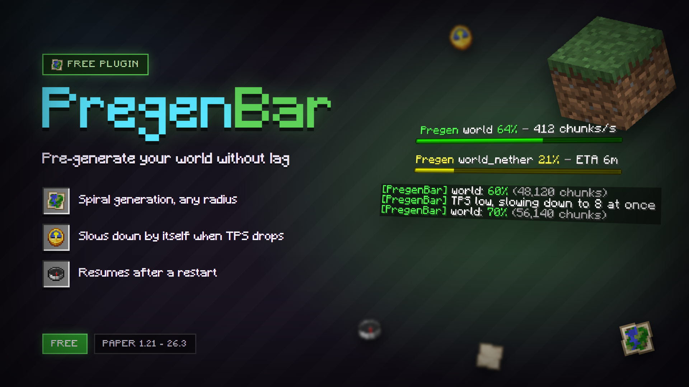

<p align="center">
  
</p>

<h1 align="center">PregenBar</h1>

<p align="center">
  <b>Free world pre-generator for Paper and Purpur, with live progress on a boss bar.</b><br>
  Generate your world ahead of time so players never cause lag exploring new chunks.
</p>

<p align="center">
  
  
  
  
</p>

---

## ✨ Features

| | |
|---|---|
| 🌀 **Spiral generation** | From the centre outwards, square or circle, any radius (`5000`, `10k`) |
| ⚡ **Async on Paper / Purpur** | Uses `World#getChunkAtAsync` with a configurable number of chunks at once (16 by default) |
| 🩺 **TPS guard** | Below 18 TPS it slows down by itself, and speeds back up when the server recovers |
| ⏭️ **Skips what exists** | Already generated chunks and, optionally, chunks outside the world border |
| 📊 **Boss bar** | Percent, chunks per second and ETA for admins, plus a console line every 10% |
| 💾 **Resumes after a restart** | Progress is saved to `progress.yml` and picks up where it stopped |
| 🌍 **Several worlds at once** | Overworld, Nether and End can run side by side |

Spigot works too, in a slower mode of one chunk per tick (Spigot has no async chunk API).

## ⌨️ Commands

Permission `pregenbar.admin` (op by default).

| Command | What it does |
|---|---|
| `/pregen start <world> <radius> [centerX centerZ] [square\|circle]` | Start a task. The centre defaults to the world border centre. |
| `/pregen pause [world]` · `resume [world]` · `cancel [world]` | The world can be left out when only one task exists. |
| `/pregen status [world]` | Percent, chunks/s, ETA, generated / skipped, TPS and current limit |
| `/pregen bar` | Hide or show the boss bar for yourself |
| `/pregen reload` | Reload `config.yml` |

## ⚙️ Configuration

```yaml
generation:
  max-concurrent: 16        # chunks generated at the same time (Paper / Purpur)
  min-tps: 18.0             # below this the speed halves every 2 s
  skip-generated: true      # already generated chunks count as done
  respect-world-border: true
  shape: square             # or circle
  max-radius: 100000
  auto-resume: true         # continue unfinished tasks after a restart

boss-bar:
  title: '&bPregen &f%world% &8| &f%percent%% &8| &f%rate% &7chunks/s &8| &7ETA &f%eta%'
  color: BLUE
  style: SEGMENTED_10
```

Every message can be changed (or hidden with `''`) in `config.yml`, which is documented inline. `progress.yml` keeps running and paused tasks: delete it with the server stopped to forget them.

## 📥 Installation

1. Put `PregenBar-<version>.jar` in `plugins/` and start the server.
2. Run `/pregen start world 5000`.
3. Watch the boss bar. That's it.

## 🛠️ Building

```bash
./gradlew build
```

Java 21. The jar ends up in `build/libs/`.

## 📄 License

© byebye_gg. All rights reserved. The source is public to read and learn from; the plugin itself is free.
